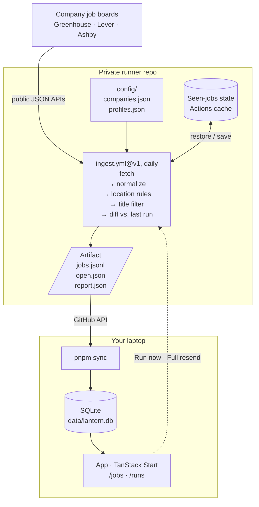

# Lantern

Lantern finds job postings on company job boards, keeps the ones that match what you're looking for, and shows them in a small local app.

It reads the public job-board APIs that companies already publish (Greenhouse, Lever and Ashby today), so there's no scraping and no API keys. A GitHub Action fetches every company on your watchlist once a day, and the app on your laptop picks up the results.

> **Status:** ingestion, the daily Action, local sync into SQLite, watchlist tools, rules-based ranking, a job inbox (Interested / Applied / Dismissed) and resume tailoring work end to end.

## How it works



- **One adapter per source.** Each turns a board's raw postings into one shared, Zod-validated `Job` shape. A bad posting is reported and skipped; it never fails the company, and one failing company never fails the run.
- **Rules first, LLM later.** Location eligibility (Canada on-site, hybrid, remote-OK, US-only and so on) is decided by rules in the Action, using structured fields first and location text second. The few jobs the rules can't place are kept and marked `unknown`, for a local LLM pass to resolve. No API keys ever go into the Action.
- **Incremental and safe to repeat.** The Action keeps a small "seen jobs" state in its cache and sends only new and changed jobs. `open.json` lists every currently open job for companies that were fetched completely, so closed jobs can be detected without a failed fetch ever closing anything.
- **Idempotent sync.** Sync applies each run in one SQLite transaction, oldest first: upsert new and changed jobs, close jobs a complete fetch no longer lists, reopen ones that come back, and flag runs whose results were missed. Running it twice changes nothing, and it never touches your own fields (status, notes).
- **Public code, private data.** This repo holds only code. Your watchlist, profiles, logs and results live in your own private runner repo, which calls this repo's reusable workflow at a pinned tag.
- **Polite by default.** At most 4 companies at once, a pause between them, timeouts, retries with backoff, and a plain User-Agent.

## Try it locally

Needs Node 22 or newer (see `.nvmrc`) and pnpm 12.

```bash
pnpm install
pnpm cli init-runner my-lantern-runner --local-only   # makes ../my-lantern-runner with example config
pnpm cli ingest --config ../my-lantern-runner/config --dry-run
pnpm cli ingest --config ../my-lantern-runner/config --out out/
pnpm sync --from out/                                  # load that result into data/lantern.db
pnpm dev                                               # then open http://localhost:3000/jobs
```

`--dry-run --all` also lists the jobs the filter dropped, and why.

## Run it daily on GitHub

```bash
pnpm cli init-runner my-lantern-runner
```

This creates a **private** repo from [`runner-template/`](runner-template) and pushes it with the GitHub CLI. Edit its `config/companies.json` and `config/profiles.json`, and its workflow runs every morning. See the [runner README](runner-template/README.md) for the config format and manual runs.

Then point the app at it: copy `.env.example` to `.env` and set `LANTERN_RUNNER_REPO`. For the token, create a [fine-grained personal access token](https://github.com/settings/personal-access-tokens/new) for the runner repo only, with **Actions** read and write (sync, Run now) and **Contents** read and write (the watchlist), and set `LANTERN_GITHUB_TOKEN`. (Without one, sync falls back to your `gh` CLI login.)

```bash
pnpm sync                 # pull new runs into SQLite
pnpm cli run              # start a run now; sync again in a minute
pnpm cli run --full-resend   # if sync reports missed results
```

The app also syncs when it starts, and has Sync and Run now buttons on `/jobs` and a run history on `/runs`.

## Growing the watchlist

```bash
pnpm cli detect-ats https://jobs.ashbyhq.com/acme/…   # or any careers-page URL
pnpm cli detect-ats https://acme.com/careers --add    # and add it to your watchlist
pnpm cli hn-suggest                                   # companies from HN's latest "Who is hiring?"
pnpm cli suggestions                                  # then: suggestions accept|reject <id>
```

- **`detect-ats`** reads a board link directly (Greenhouse, Lever, Ashby; Workday, BambooHR and a few others are recognized but not supported yet). For a company's own site, it looks for a board linked in the page, then tries the company name as a slug on each board. Every result is checked against the real API: how many jobs are open, and how many pass your profile today.
- **`hn-suggest`** reads the latest HN "Who is hiring?" thread, keeps posts that mention Canada or remote work, finds each company's board the same way, and saves the new ones as suggestions, sorted by matching jobs. Companies you've accepted or rejected aren't suggested again.
- **Guessed boards** are labelled, since another company can own the same slug. Greenhouse reports a board's company name, so a guessed Greenhouse board whose name doesn't fit is dropped; for Ashby and Lever, open the board to check.
- The **`/watchlist`** page does all of this in the app: add from a URL, check HN, and accept or reject suggestions. Accepting commits one line to `config/companies.json` in your runner repo (the token needs Contents read/write); the next run picks it up. Every command also takes `--config <dir>` to use a local folder instead.

## Ranking

`/jobs` lists the best matches first, scored by `config/criteria.json` in your runner repo. Scoring is plain rules, so every point shows up as a reason when you open a job:

- **`signals`**: `{ label, phrases[], weight, in? }`. If any phrase matches, `weight` is added once. Phrases are whole words, ignoring case, like the profile filter. `in` is `title`, `description`, `location` (the posting's location text, for a city) or `any` (title or description, the default). Use negative weights to push jobs down.
- **`dealbreakers`**: `{ label, phrases[], in? }`. A match sinks the job to the bottom of the list, dimmed and labelled.
- **`eligibility`**: points per location type, for example `{ "remote_canada_ok": 10, "canada_hybrid": 4 }`.
- **`salary`**: `{ currency, floor, belowFloor }`. Adds `belowFloor` (0 or less) when an annual salary in that currency tops out below `floor`. A missing salary is neutral.

Start from `runner-template/config/criteria.example.json`, then tune it in the terminal against a local checkout of your runner repo:

```bash
pnpm cli rank --config ../lantern-runner/config               # open jobs, best first, with reasons
pnpm cli rank --config ../lantern-runner/config --explain 3fa2 # one job's points (id prefix)
```

The app reads the criteria again on every Sync. To try changes in the app before pushing them, set `LANTERN_CONFIG_DIR=../lantern-runner/config` in `.env`. Without a `criteria.json`, jobs are listed newest first.

## Tailoring

**Tailor resume** in a job's detail pane tailors your resume to that posting. It works from `config/resume.json` in your runner repo, your master resume as data: basics, summary, skill groups, and jobs whose bullets each have an `id`. Start from `runner-template/config/resume.example.json`.

Tailoring never invents. The model may only pick, reorder and lightly reword your bullets, reorder skills, and rewrite the summary. Employers, titles, dates and education always come from `resume.json`. Code then checks the result: a reworded bullet can't contain a number its original doesn't, skills must already be in your resume, and bullets can't move between jobs. Anything that fails is dropped or reverted to your wording, and terms your resume never mentions are flagged for you to look at.

You review each change (accept or revert), with a live preview. **Open** shows the resume as its own page to print to PDF (⌘P), and **Download HTML** saves it as a standalone file. Each run is kept as a version, and marking a job Applied records which version you used.

It runs the [Claude Code](https://code.claude.com) CLI (`claude -p`) on your Claude subscription, not the API: install it and sign in once with `claude auth login`. Lantern removes `ANTHROPIC_API_KEY` from the CLI's environment so it never bills an API key. Settings in `.env`: `LANTERN_CLAUDE_BIN` (default `claude`), `LANTERN_TAILOR_MODEL` (default `opus`), `LANTERN_TAILOR_EFFORT` (default `medium`).

```bash
pnpm cli tailor 3fa2 --config ../lantern-runner/config   # tailor one job (id prefix) and print the changes
```

## Development

| Command                         | What it does                                           |
| ------------------------------- | ------------------------------------------------------ |
| `pnpm dev`                      | App at http://localhost:3000                           |
| `pnpm cli ingest …`             | Ingestion CLI (`pnpm cli --help`)                      |
| `pnpm sync`                     | Pull new runner results into `data/lantern.db`         |
| `pnpm cli hn-suggest`           | Suggest companies from HN's "Who is hiring?"           |
| `pnpm cli rank`                 | Print open jobs ranked by `criteria.json`              |
| `pnpm cli tailor <job id>`      | Tailor `resume.json` to one job with `claude -p`       |
| `pnpm db:generate`              | New migration after editing `src/db/schema.ts`         |
| `pnpm check`                    | Format check, lint, typecheck and tests (what CI runs) |
| `pnpm format` / `pnpm lint:fix` | Fix formatting / auto-fixable lint                     |

Stack: TypeScript 7, TanStack Start, SQLite (Drizzle + better-sqlite3), Zod, Vitest, oxlint (type-aware, via tsrs) and oxfmt.

```
src/pipeline/         ingestion: adapters/, eligibility, filter, state, CLI
src/pipeline/__tests__/  unit tests, with trimmed real API responses as fixtures
src/routes/           app pages
src/server/           server functions
src/db/               SQLite schema (Drizzle); migrations in drizzle/
src/sync/             GitHub client and sync
src/watchlist/        detect-ats, HN miner, suggestions, runner config edits
runner-template/      what `init-runner` copies into your private runner repo
.github/workflows/    ci.yml, and ingest.yml (the reusable workflow runners call)
```

## License

[MIT](LICENSE)
