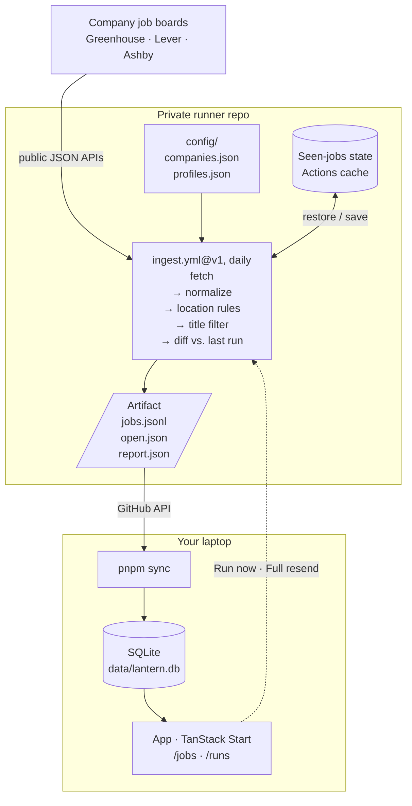

# Lantern

Lantern finds job postings on company job boards, keeps the ones that match what you're looking for, and shows them in a small local app.

It reads the public job-board APIs that companies already publish (Greenhouse, Lever and Ashby today), so there's no scraping and no API keys. A GitHub Action fetches every company on your watchlist once a day, and the app on your laptop picks up the results.

> **Status:** ingestion, the daily Action and local sync into SQLite work end to end, with a jobs page and run history. Ranking and resume tailoring are next.

## How it works



- **One adapter per source.** Each turns a board's raw postings into one shared, Zod-validated `Job` shape. A bad posting is reported and skipped; it never fails the company, and one failing company never fails the run.
- **Rules first, LLM later.** Location eligibility (Canada on-site, hybrid, remote-OK, US-only and so on) is decided by rules in the Action, using structured fields first and location text second. The few jobs the rules can't place are kept and marked `unknown`, for a local LLM pass to resolve. No API keys ever go into the Action.
- **Incremental and safe to repeat.** The Action keeps a small "seen jobs" state in its cache and sends only new and changed jobs. `open.json` lists every currently open job for companies that were fetched completely, so closed jobs can be detected without a failed fetch ever closing anything.
- **Idempotent sync.** Sync applies each run in one SQLite transaction, oldest first: upsert new and changed jobs, close jobs a complete fetch no longer lists, reopen ones that come back, and flag runs whose results were missed. Running it twice changes nothing, and it never touches your own fields (status, notes).
- **Public code, private data.** This repo holds only code. Your watchlist, profiles, logs and results live in your own private runner repo, which calls this repo's reusable workflow at a pinned tag.
- **Polite by default.** At most 4 companies at once, a pause between them, timeouts, retries with backoff, and a plain User-Agent.

## Try it locally

Needs Node 22 or newer (see `.nvmrc`) and pnpm 12.

```bash
pnpm install
pnpm cli init-runner my-lantern-runner --local-only   # makes ../my-lantern-runner with example config
pnpm cli ingest --config ../my-lantern-runner/config --dry-run
pnpm cli ingest --config ../my-lantern-runner/config --out out/
pnpm sync --from out/                                  # load that result into data/lantern.db
pnpm dev                                               # then open http://localhost:3000/jobs
```

`--dry-run --all` also lists the jobs the filter dropped, and why.

## Run it daily on GitHub

```bash
pnpm cli init-runner my-lantern-runner
```

This creates a **private** repo from [`runner-template/`](runner-template) and pushes it with the GitHub CLI. Edit its `config/companies.json` and `config/profiles.json`, and its workflow runs every morning. See the [runner README](runner-template/README.md) for the config format and manual runs.

Then point the app at it: copy `.env.example` to `.env` and set `LANTERN_RUNNER_REPO`. For the token, create a [fine-grained personal access token](https://github.com/settings/personal-access-tokens/new) for the runner repo only, with **Actions** and **Contents** read and write, and set `LANTERN_GITHUB_TOKEN`. (Without one, sync falls back to your `gh` CLI login.)

```bash
pnpm sync                 # pull new runs into SQLite
pnpm cli run              # start a run now; sync again in a minute
pnpm cli run --full-resend   # if sync reports missed results
```

The app also syncs when it starts, and has Sync and Run now buttons on `/jobs` and a run history on `/runs`.

## Development

| Command                         | What it does                                           |
| ------------------------------- | ------------------------------------------------------ |
| `pnpm dev`                      | App at http://localhost:3000                           |
| `pnpm cli ingest …`             | Ingestion CLI (`pnpm cli --help`)                      |
| `pnpm sync`                     | Pull new runner results into `data/lantern.db`         |
| `pnpm db:generate`              | New migration after editing `src/db/schema.ts`         |
| `pnpm check`                    | Format check, lint, typecheck and tests (what CI runs) |
| `pnpm format` / `pnpm lint:fix` | Fix formatting / auto-fixable lint                     |

Stack: TypeScript 7, TanStack Start, SQLite (Drizzle + better-sqlite3), Zod, Vitest, oxlint (type-aware, via tsrs) and oxfmt.

```
src/pipeline/         ingestion: adapters/, eligibility, filter, state, CLI
src/pipeline/__tests__/  unit tests, with trimmed real API responses as fixtures
src/routes/           app pages
src/server/           server functions
src/db/               SQLite schema (Drizzle); migrations in drizzle/
src/sync/             GitHub client and sync
runner-template/      what `init-runner` copies into your private runner repo
.github/workflows/    ci.yml, and ingest.yml (the reusable workflow runners call)
```

## License

[MIT](LICENSE)
